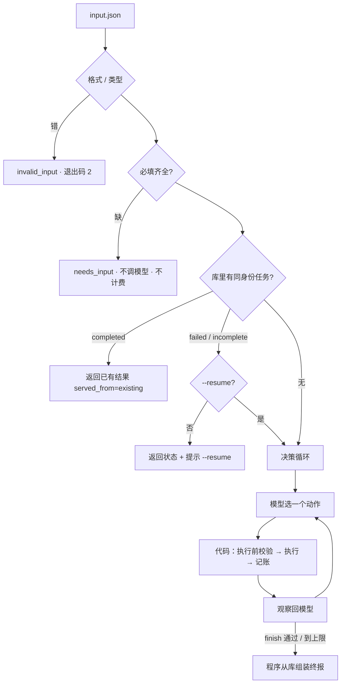

# 方案

一句话：**模型负责业务选择，代码负责事实、约束与记账。**



## 决策循环（ReAct 机制 + Plan-Execute-Replan 策略）

每轮：模型调用**一个**工具 → 代码校验与执行 → 结构化观察（含拒绝原因）回给模型 → 模型决定下一步。
七个动作：`propose_plan` `revise_plan` `estimate_cost` `search_materials` `generate_script` `save_plan` `finish`，每个带必填 `reason`（审计用）。

| 由模型决定 | 由代码保证 |
|---|---|
| 搜几次、搜什么词；脚本几份、各用什么档位 | 步骤在计划里、依赖已完成、同一步骤 ≤2 次尝试 |
| 超预算 / 超时间时改哪一项、还是停止 | 执行前当前版本必须有估算，且在预算与截止时间内 |
| 步骤失败后重试、换档还是放弃 | 失败不计费、成功结果不可擦除；档位取自计划 |
| 搜索无命中后换词还是停止 | `material_ids` 只能来自依赖的搜索结果 |
| 什么时候结束 | `finish(completed)` 必须已保存且账实一致，否则打回 |

**什么不算模型决策**：代码不会自动换档、不会自动重试、不会替模型删步骤。正常路径的 trace 看起来像 workflow；区别只在出岔子时体现（注入失败、超预算、空结果）。

## 费用口径

```
spent        已成功执行且计费之和（账本）        remaining  当前计划未完成步骤的预计费用
projected    spent + remaining（预算约束看它）    min_feasible  满足必需交付的最低总费用
```
模拟时钟 `sim_now` 从输入 `now` 起，每个成功步骤推进其工时（串行）。完成时 remaining = 0，projected = spent。

## 模块

| 模块 | 职责 | 关键函数 |
|---|---|---|
| `src/schema.py` | 输入三段校验、规范化 + SHA-256 指纹、pydantic 模型、工具 schema | `check_input` `fingerprint` `tool_schemas` |
| `src/store.py` | SQLite 六表；成功步骤的状态 / 结果 / 账本 / 时钟同事务 | `record_step_success` `save_plan` `load_plan` |
| `src/plan.py` | 结构校验（无环、恰好一个必需 main 且依赖搜索）、原子修订、估算、保存阻塞项 | `build_plan` `apply_revision` `estimate` `save_blockers` |
| `src/tools.py` | 七个动作：执行前校验 → 执行 → 记账；故障注入；模板脚本；调整说明 | `Tools.execute` `_precheck` `_run_step` |
| `src/llm.py` | OpenAI 兼容客户端（qwen-plus，temperature 0，timeout 60s，max_retries 1）；MockLLM | `OpenAICompatClient.chat` `MockLLM` |
| `src/loop.py` | 每轮一个动作、动作上限（默认 15，计所有动作含 finish 与被拒）、重复动作提醒；读取并填充提示词模板 | `run_loop` `build_system_prompt` |
| `src/prompts/system.md` | 系统提示词模板（`string.Template` 的 `$变量` 占位）：角色、工具、费用表、本次任务、硬约束、决策选项 | — |
| `src/trace.py` | 追加式 JSONL；审阅版（步骤 / 参数 / 返回摘要 / 后续动作 / 决策依据） | `Trace.event` `Trace.review` |
| `src/report.py` | 终报全部取自库；`adjustments`、`user_message`（给运营，白话）与 `handoff_note`（出问题时给负责人的转交说明） | `build_report` |
| `src/main.py` | CLI、身份分流、`--resume` / `--new-task` / `--inject` / `--mock`、`dump` | `run_request` |

## 状态值

- 运行：`completed | incomplete | failed`；入口层：`needs_input | invalid_input | request_conflict | not_found`。
- 步骤：`pending | running | done | failed | skipped`，只由执行器写入。
- 观察错误码：`plan_exists` `no_plan` `step_not_in_plan` `action_mismatch` `deps_not_done` `retry_limit_reached` `estimate_required` `over_budget` `over_deadline` `unknown_material` `required_deliverable_missing` `step_already_done` `not_saveable` `finish_rejected` `tool_error` `invalid_args`。

## 身份与重复执行

身份 = `request_id`（有则用）否则 `fp:<指纹>`。指纹 = 规范化后的 topic / budget / deadline / quality_preference 的 SHA-256；`now` 与 `request_id` 不参与。
同身份再次提交：completed → 直接返回已有结果，零新事件、不重复计费；failed/incomplete → 只返回状态，显式 `--resume` 才续跑（新重试窗口，已完成步骤与费用保留）。同 `request_id` 不同参数 → `request_conflict`。

## 取舍

- **手写循环而非 LangGraph**：工具少、串行、单模型；一次"调用-校验-反馈-终止"循环比引入框架省时且每行可解释。框架不加分，可解释才有价值。
- **SQLite 而非 JSON 文件**：幂等、续跑、账实核对都需要事务与唯一约束。
- **finish 是会失败的工具**：防止"未保存就宣称完成"；终报由程序组装，模型只提供意图与一句总结。
- **脚本用确定性模板**：考点是约束下的规划与重规划，不是文案质量；模板让 17 项测试完全确定。接口预留 `SCRIPT_BACKEND=llm`，未实现。
- **失败不计费**：简化账目核对；真实业务中失败也可能产生费用，属 v2。

## 局限

单进程、单用户；素材匹配是关键词/标签打分；`now` 可由输入注入便于测试，生产应只取系统时间；步数上限默认 15，按最长合法路径（10 步）验证。
